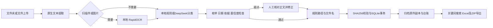

# 架构与 Agent 工作流

归序采用有边界的工具工作流：文件发现 → 本地提取 → 本地规则或模型分类 → 本地核验 → 人工复核 → 无损归档 → 持久台账与导出。模型不会运行命令、选择工具或决定物理输出路径。

## 模块

`oa/core.py` 实现提取器、模型客户端、结构化校验、命名路径、哈希去重及归档台账。`oa/server.py` 提供仅监听127.0.0.1的HTTP服务和后台识别线程。`oa/web/index.html` 是本地图形工作台，无CDN和前端构建依赖。`main.py` 为统一启动入口，Windows可用PyInstaller打包为独立程序。

## 分类规则配置

可配置部门及类型枚举；`template_hint` 定义企业文档字段含义；`name_template` 只允许 department、type、date、title 占位符。默认输出 `部门/类型/YYYY-MM/部门_类型_YYYY-MM-DD_标题.ext`。无独立向量知识库：企业规则和当前正文组成每次请求的上下文，不虚构知识库接入。

模型输入为文件名、正文和字段定义。输出为部门、类型、生成日期、标题、自评置信度和原文引文。响应必须是JSON对象，非枚举字段、非法或缺失日期、无法在原文定位的依据、低于阈值的结果进入待复核。自评置信度不代表统计准确率。

本地规则优先定位所属部门、发文部门、归口单位等标签，再检查文件名和正文中的部门枚举；类型优先显式标签和文件名，再检查标题关键词；日期只使用生成、签发、签署、制发等明确标签，或文件名中的完整年月日。多候选或缺失进入待复核。本地规则记录 `local-rules-v1`，请求编号为空，不计算模型置信度。两种模式由用户明确选择，模型请求失败不会暗中改为本地结果。

## 数据及保护边界

OCR在本机运行。模型服务接收提取正文（至多18000字符）与文件名；不会接收二进制原件。API Key由环境变量或本机配置读取，不写入台账、公开文档或导出包。配置界面不回显已有Key。

图形服务仅绑定回环地址；写入接口要求每次启动生成的随机令牌并核验Origin。文档内容是待分析数据，不能覆盖系统规则。路径经本地字符清理并校验不得逃出指定目录。Excel自由文本防公式注入。

归档仅复制原件。复制前后核验SHA256；识别后原件若变化则拒绝归档。SQLite事务串行化去重与名称冲突处理。同内容不重复归档，同名不同内容添加哈希后缀。失败时回滚台账并清理本次写入副本。进程被强制终止可能留下未入账副本，重新运行会以冲突名称保护文件。

## 提取范围

支持DOCX段落与表格；正文过少时提取最多10张内嵌图片。Excel每表读取前1000行的缓存值。PDF读取前12页，文字不足时OCR；多帧图像最多12帧。每文件80 MB，模型输入截取前18000字符。触及截取限制会进入待复核，完整原件仍原样归档。旧式二进制`.doc`请先另存DOCX；加密文件需先解密。
